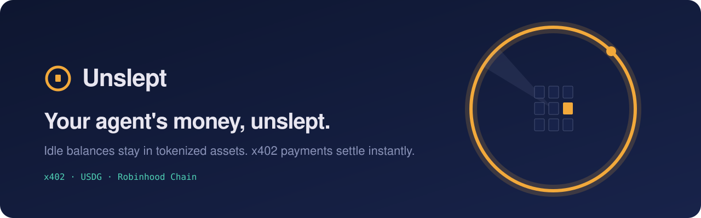
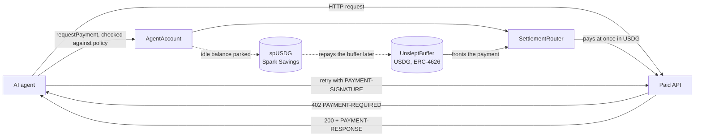

<p align="center">
  
</p>

<p align="center">
  <a href="https://github.com/Unsleptxyz/Unslept/actions/workflows/ci.yml"></a>
  <a href="https://www.npmjs.com/package/@unslept/sdk"></a>
  <a href="https://www.npmjs.com/package/@unslept/mcp"></a>
  <a href="https://pypi.org/project/unslept/"></a>
  <a href="LICENSE"></a>
  
</p>

<p align="center">
  <a href="https://www.unslept.xyz">Website</a> ·
  <a href="https://www.unslept.xyz/docs">Docs</a> ·
  <a href="https://www.unslept.xyz/app">App</a> ·
  <a href="https://www.unslept.xyz/risk">Risk disclosure</a>
</p>

---

**Unslept is a yield-bearing payment layer for AI agents on Robinhood Chain.** Every agent holds idle cash between
payments. Unslept keeps that balance in tokenized assets while it waits, and pays HTTP 402 (x402) requests the
instant they are due from a shared USDG buffer. The agent never waits for an asset to be sold. Every payment stays
inside a spending policy enforced on chain.

Yield is variable and not guaranteed. See the [risk disclosure](https://www.unslept.xyz/risk).

## How it works



1. **Agent accounts.** Each agent gets its own smart account (ERC-4337 compatible) with a per-call cap, a daily
   cap, a payee allowlist and an optional domain allowlist. The owner can pause, revoke or exit at any time.
2. **Instant settlement.** When an API answers 402, the SDK asks the account to pay. Liquid cash pays first. If the
   balance is parked, the buffer fronts the payment and the account owes the buffer, never more than its collateral.
3. **Idle balances keep working.** A keeper parks idle cash in Spark Savings USDG (spUSDG). Anyone can call
   `settleDebt` to repay the buffer from the parked position.
4. **Buffer depositors.** Depositors provide the USDG that settles payments and earn the instant-settlement fee
   (currently 0.10 percent, bounded on chain). Withdrawals are instant while liquidity allows, otherwise queued.

## Quickstart

```bash
npm install @unslept/sdk viem
```

```ts
import { Unslept } from "@unslept/sdk";
import { privateKeyToAccount } from "viem/accounts";

const unslept = new Unslept({
  agentAccount: process.env.UNSLEPT_AGENT_ACCOUNT,
  signer: privateKeyToAccount(process.env.UNSLEPT_SIGNER_KEY as `0x${string}`),
  network: "robinhood-chain",
});

// Pays the 402 challenge from the agent account, then retries with the payment proof.
const res = await unslept.fetch("https://www.unslept.xyz/api/demo/x402", undefined, { maxAmount: 50_000n });
```

Python, LangChain, CrewAI and MCP quickstarts are in the [docs](https://www.unslept.xyz/docs).

| Package | Install | Use |
|---|---|---|
| [`@unslept/sdk`](packages/sdk-ts) | `npm install @unslept/sdk viem` | TypeScript client with the x402 interceptor |
| [`@unslept/mcp`](packages/mcp) | `npx -y @unslept/mcp` | MCP server: let a model pay x402 requests within policy |
| [`unslept`](packages/sdk-py) | `pip install "unslept[web3]"` | Python client, LangChain tool |

## Mainnet deployment

Robinhood Chain mainnet, chain ID `4663`. All sources are verified (exact match) on Sourcify and readable on the
explorer. Admin rights sit behind a 24-hour timelock.

| Contract | Address |
|---|---|
| UnsleptBuffer | [`0xcD853fb30eCe3134Cf21e2f47B9e23eaf965F40D`](https://robinhoodchain.blockscout.com/address/0xcD853fb30eCe3134Cf21e2f47B9e23eaf965F40D) |
| SettlementRouter | [`0x1FeAB3B8f88FB0667B686fDCB0206194e88c984b`](https://robinhoodchain.blockscout.com/address/0x1FeAB3B8f88FB0667B686fDCB0206194e88c984b) |
| AgentAccountFactory | [`0xCa7D38A833BFaCBE22E787f967552A78b07C1c77`](https://robinhoodchain.blockscout.com/address/0xCa7D38A833BFaCBE22E787f967552A78b07C1c77) |
| Allocator | [`0x5684a28Ef362f1282Eb7ef7e4C154F5e21FEfcfd`](https://robinhoodchain.blockscout.com/address/0x5684a28Ef362f1282Eb7ef7e4C154F5e21FEfcfd) |
| FeeModule | [`0xacbE1938C5CA8EaeB06C9E5c7c7E3b5d4d75fAEC`](https://robinhoodchain.blockscout.com/address/0xacbE1938C5CA8EaeB06C9E5c7c7E3b5d4d75fAEC) |
| ERC4626Adapter (spUSDG) | [`0xAf7f74801C2b439831feef6D1b4d39B4Ce717B66`](https://robinhoodchain.blockscout.com/address/0xAf7f74801C2b439831feef6D1b4d39B4Ce717B66) |
| TimelockController | [`0x2A407119d55e5cca2D51Cacc78000D49FeEcE777`](https://robinhoodchain.blockscout.com/address/0x2A407119d55e5cca2D51Cacc78000D49FeEcE777) |
| USDG (Paxos) | [`0x5fc5360D0400a0Fd4f2af552ADD042D716F1d168`](https://robinhoodchain.blockscout.com/address/0x5fc5360D0400a0Fd4f2af552ADD042D716F1d168) |
| spUSDG (Spark Savings) | [`0xde770c84FE66E063336b31737cFE9790f18c4087`](https://robinhoodchain.blockscout.com/address/0xde770c84FE66E063336b31737cFE9790f18c4087) |

Machine-readable: [`contracts/deployments/4663.json`](contracts/deployments/4663.json). Role checks:
[`4663.checks.txt`](contracts/deployments/4663.checks.txt). Verification:
[`4663.verify.txt`](contracts/deployments/4663.verify.txt).

## Security

> [!IMPORTANT]
> Unslept is in a **guarded launch**. The contracts have not completed a third-party audit. Total buffer deposits
> and each asset adapter are capped at 50,000 USDG. Use only amounts you can afford to lose.

- 46 unit, fuzz and invariant tests, plus a [mainnet fork test](contracts/test/fork/MainnetFork.t.sol) that runs
  the full flow against the live contracts, real USDG and real spUSDG.
- Every admin change goes through a 24-hour timelock and is visible on chain before it takes effect.
- Protocol health is checked every 15 minutes. New alerts open an issue labelled `ops-alert`.
- Report vulnerabilities privately. See [SECURITY.md](SECURITY.md).

## Repository layout

| Path | Contents |
|---|---|
| [`contracts/`](contracts) | Foundry. Buffer, agent accounts and factory, settlement router, allocator, fee module, adapters, staking, deploy script, tests |
| [`web/`](web) | Next.js site, app, docs, live x402 demo endpoint, lightweight indexer and alert crons |
| [`packages/`](packages) | `@unslept/sdk`, `@unslept/mcp`, `unslept` (Python) |
| [`examples/`](examples) | Sample x402 v2 endpoint accepting `unslept-direct` and `exact` |
| [`monitor/`](monitor), [`ops/`](ops) | Health monitor, keeper, operational records |
| [`indexer/`](indexer) | Ponder indexer for full payment history (optional) |
| [`supabase/`](supabase) | Database schema |
| [`RUNBOOK.md`](RUNBOOK.md), [`PLAN.md`](PLAN.md) | Operations runbook and design plan |

## Development

```bash
cd contracts && forge test                         # unit, fuzz, invariant
FORK_RPC=https://rpc.mainnet.chain.robinhood.com \
  forge test --match-path "test/fork/*" -vv         # full flow on a mainnet fork, no real funds
cd packages/sdk-ts && npm test                     # SDK
cd packages/mcp && npm test                        # MCP server
cd packages/sdk-py && python -m pytest tests       # Python SDK
./scripts/e2e.sh                                   # local chain end to end
cd web && npm run build && npm run copy-check      # site, and the copy rules
```

Conventions this codebase keeps:

- No hardcoded chain values in application code. Everything comes from the environment (see `.env.example`).
- Yield is always described as variable, historical or illustrative. No promise of returns.
- `npm run copy-check` enforces the copy rules on the website.

## License

[MIT](LICENSE). Smart contract sources in `contracts/src` keep the SPDX identifier they were deployed and verified
with; see [NOTICE](NOTICE).
