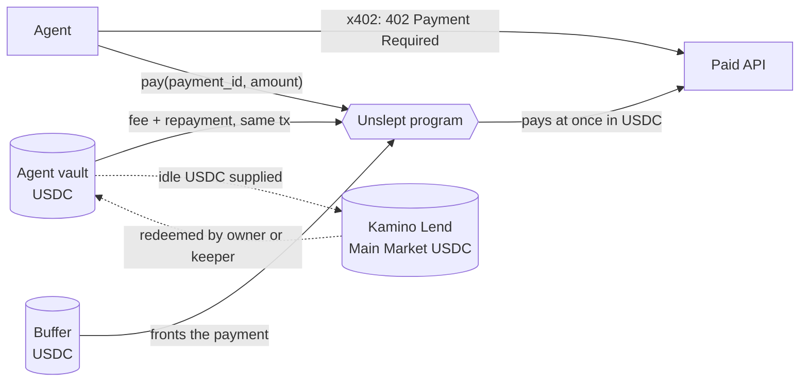

<p align="center">
  
</p>

<p align="center">
  <a href="https://github.com/Unsleptxyz/Unslept/actions/workflows/ci.yml"></a>
  <a href="https://www.npmjs.com/package/@unslept/sdk"></a>
  <a href="https://www.npmjs.com/package/@unslept/mcp"></a>
  <a href="https://pypi.org/project/unslept/"></a>
  <a href="LICENSE"></a>
  
</p>

<p align="center">
  <a href="https://www.unslept.xyz">Website</a> ·
  <a href="https://www.unslept.xyz/docs">Docs</a> ·
  <a href="https://www.unslept.xyz/app">App</a> ·
  <a href="https://www.unslept.xyz/risk">Risk disclosure</a>
</p>

---

**Unslept is a yield-bearing payment layer for AI agents on Solana.** Every agent holds idle USDC between payments.
Unslept lets that balance earn on Kamino Lend and settles every x402 payment the instant it is due from a shared USDC
buffer. The agent never waits for its money. Every payment stays inside a spending policy enforced on-chain.

## How it works



1. **Agent accounts.** Each agent has an account in the Unslept program, owned by your wallet. The agent's key can only
   call `pay`, inside a per-call cap, a daily cap and an optional payee allowlist. It can never withdraw.
2. **Instant settlement.** On a 402 the SDK sends one transaction: the buffer pays the merchant, the fee goes to the
   treasury, and the agent repays the buffer from its liquid USDC. A Payment record proves the payment to the merchant.
3. **Idle balances keep working.** Owners supply idle agent USDC to Kamino. Any part of a payment not repaid at once
   stays as debt, capped at 95% of the Kamino position, and is repaid when the keeper or owner redeems.
4. **Buffer depositors** provide the USDC that settles payments and earn the settlement fee. Variable, can be zero.

## Quickstart

```bash
npm install @unslept/sdk @solana/web3.js
```

```ts
import { Unslept } from "@unslept/sdk";
import { Keypair } from "@solana/web3.js";

const unslept = new Unslept({
  agent: process.env.UNSLEPT_AGENT,
  signer: Keypair.fromSecretKey(agentSecretKey),
  network: "solana",
});

// Pays the 402 challenge from the agent account, then retries with the payment proof.
const res = await unslept.fetch("https://www.unslept.xyz/api/demo/x402", undefined, { maxAmount: 50_000n });
```

| Package | Install | Use |
|---|---|---|
| [`@unslept/sdk`](packages/sdk-ts) | `npm install @unslept/sdk @solana/web3.js` | TypeScript client with the x402 interceptor |
| [`@unslept/pay`](packages/pay) | `npm install @unslept/pay` | Merchant paywall: accept x402 payments in USDC |
| [`@unslept/mcp`](packages/mcp) | `npx -y @unslept/mcp` | MCP server: let a model pay x402 requests within policy |
| [`unslept`](packages/sdk-py) | `pip install "unslept[solana]"` | Python client, LangChain tool |

## Mainnet

| | Address |
|---|---|
| Unslept program | [`HbAgL4w8R9D8RUEuK4rJknK5Vn8rBusfRtfTnFcYieue`](https://solscan.io/account/HbAgL4w8R9D8RUEuK4rJknK5Vn8rBusfRtfTnFcYieue) |
| USDC | [`EPjFWdd5AufqSSqeM2qN1xzybapC8G4wEGGkZwyTDt1v`](https://solscan.io/token/EPjFWdd5AufqSSqeM2qN1xzybapC8G4wEGGkZwyTDt1v) |
| Kamino Main Market USDC reserve | [`D6q6wuQSrifJKZYpR1M8R4YawnLDtDsMmWM1NbBmgJ59`](https://solscan.io/account/D6q6wuQSrifJKZYpR1M8R4YawnLDtDsMmWM1NbBmgJ59) |

The earlier Robinhood Chain deployment (USDG) is retired; its contracts stay in [`contracts/`](contracts) for reference.

## Security

> **Guarded launch.** The program has not completed a third-party audit. Buffer deposits are capped at 50,000 USDC.
> Use only amounts you can afford to lose.

- Anchor tests on a local validator, plus a mainnet-fork suite that runs the Kamino adapter, the SDK and the
  `@unslept/pay` paywall against the real Kamino Lend program and the live USDC reserve.
- Parameter changes wait 24 hours on-chain. Pause stops deposits and payments; withdrawals stay open.
- Design notes: [`docs/solana-design.md`](docs/solana-design.md). Reports: [SECURITY.md](SECURITY.md).

## Repository layout

| Path | Contents |
|---|---|
| [`solana/`](solana) | Anchor program, tests, mainnet-fork tests, keeper and ops scripts |
| [`web/`](web) | Next.js site, app, docs, live x402 demo endpoint and indexer |
| [`packages/`](packages) | `@unslept/sdk`, `@unslept/pay`, `@unslept/mcp`, `unslept` (Python) |
| [`examples/`](examples) | Agent and paywall templates |
| [`contracts/`](contracts) | Retired Robinhood Chain contracts (Foundry) |

## Development

```bash
cd solana && anchor build && anchor test --validator legacy   # program tests
bash solana/scripts/kamino-fork.sh                             # Kamino + SDK + paywall on a mainnet fork
cd packages/sdk-ts && npm test                                 # SDK
cd packages/pay && npm test                                    # paywall
cd packages/mcp && npm test                                    # MCP server
cd packages/sdk-py && python -m unittest discover -s tests     # Python SDK
cd web && npm run build && npm run copy-check                  # site, and the copy rules
```

Yield is always described as variable, historical or illustrative. No promise of returns.

## License

[MIT](LICENSE). Smart contract sources in `contracts/src` keep the SPDX identifier they were deployed and verified
with; see [NOTICE](NOTICE).
